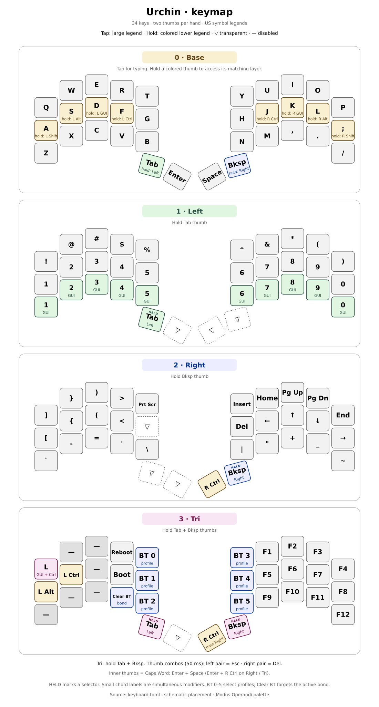
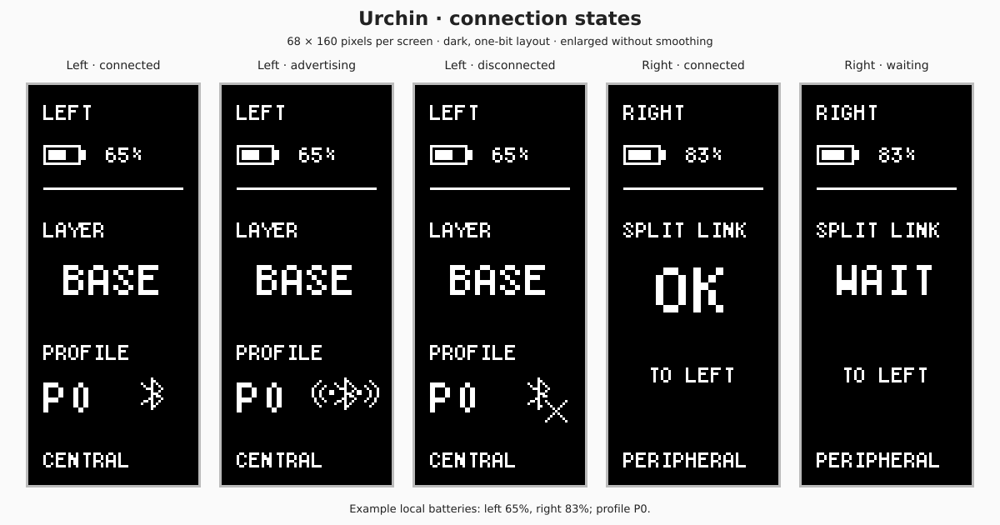
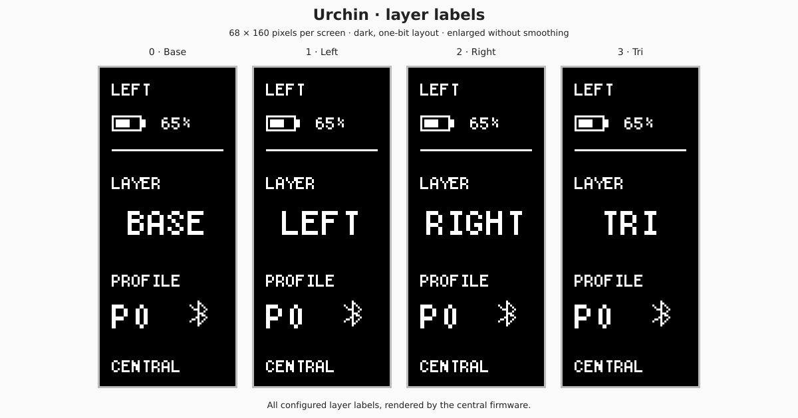

# Urchin firmware

Felipe Balbi's RMK-based firmware for the Urchin split keyboard, using
nice!nano controllers, a BLE split link, USB/BLE host connections, and a
nice!view status screen on each half.

`keyboard.toml` defines the matrix, seven layers, and key behavior.
`src/central.rs` and `src/peripheral.rs` are the two firmware entry points;
the shared display implementation lives in `src/screen.rs`, `src/screen/`,
`src/nice_view.rs`, and `src/display_spi.rs`.

## Keymap



The diagram shows the compiled defaults in `keyboard.toml`, using schematic
34-key placement and US symbol legends. Regenerate it with
`python3 assets/generate-keymap.py` (Python 3.11 or newer).

This ports the QWERTY layout from [rmk-remake](https://github.com/felipebalbi/rmk-remake),
based on [Miryoku's layer structure](https://github.com/manna-harbour/miryoku/tree/master/docs/reference).
Urchin has **two thumbs per hand**, so a same-hand two-thumb chord takes the
place of Miryoku's **tertiary** (third) thumb. This is unrelated to Miryoku's
alternate alpha layer named Extra, which is not enabled here. There is no Tri layer.

Existing physical thumb tap positions are preserved, from left to right:

| Left Tab thumb | Left Enter thumb | Right Space thumb | Right Backspace thumb |
|---|---|---|---|
| Tab / hold Mouse | Enter / hold Nav | Space / hold Num | Backspace / hold Sym |
| `(3,3)` | `(3,4)` | `(3,5)` | `(3,6)` |

| Layer | Hold | Opposite-hand functions |
|---|---|---|
| Nav (1) | Left Enter | Clipboard, arrows, line/page movement, Caps Word |
| Mouse (2) | Left Tab | Pointer, wheel, mouse buttons, clipboard |
| Media (3) | **Both left thumbs** | Playback, volume, Bluetooth and USB/BLE controls |
| Num (4) | Right Space | Numpad and unshifted punctuation |
| Sym (5) | Right Backspace | Shifted symbols in matching Num positions |
| Fun (6) | **Both right thumbs** | Function keys, Print Screen, Scroll Lock, Pause, Menu |

Home-row mods remain Shift on A/semicolon, Alt on S/L, GUI on D/K, and Ctrl on
F/J. Supporting-hand sublayers have dedicated modifiers in these same positions;
opposite-hand keys are single-function. `No` keys are disabled, not transparent.

### Tertiary thumb chords

Press both thumbs **on the same hand within 50 ms**. Tap and release for the
tertiary tap; hold the chord for 200 ms to activate its layer. Release **both**
members to release the chord output/layer. Either press order and either release
order work. A chord replaces, rather than adds to, its individual thumb actions.
Presses outside the combo window remain separate thumb actions.
Pressing another key while the chord is down selects its hold layer immediately,
so fast Media/Fun chords do not leak a Base key before the timeout. The 200 ms
timeout starts when the second thumb completes the chord.

| Active layer | Both left thumbs | Both right thumbs |
|---|---|---|
| Base | **Escape / hold Media** | **Delete / hold Fun** |
| Nav | Disabled | Delete (hold for repeat) |
| Mouse | Disabled | Middle mouse button (hold for drag) |
| Media | Disabled | Mute |
| Num | Dot | Disabled |
| Sym | `(` | Disabled |
| Fun | Menu / Application | Disabled |

Thus every action of REMAKE's missing tertiary thumbs remains available, not
just base Escape and Delete. Left Tab/Enter also become Minus/0 on Num,
underscore/close parenthesis on Sym, and Tab/Enter on Fun. Right Space/Backspace
become Space/Backspace on Nav, left/right mouse buttons on Mouse, and
play-pause/stop on Media. Direct thumb keys and chord outputs on these layers
can be held for repeat or drag where the host supports it.

Caps Word moves from the old inner-thumb combo to **Nav + H**: hold Enter,
then tap H. Enter + Space is no longer a Caps Word combo, so Nav/Num holds do
not compete with it. Num + A gives `'`; Sym + A gives `"` on a US host layout.
Semicolon remains on Base; Shift + semicolon gives `:`.

Bootloader access follows REMAKE's guarded Miryoku binding: hold a layer thumb
or tertiary chord, then **double-tap the top-row pinkie on the same hand**
(Q for left-hand layers, P for right-hand layers). A single tap does not reset.

Clipboard uses Shift+Insert paste, Ctrl+Insert copy, Shift+Delete cut, HID Undo,
and **Ctrl+Y Redo**. Application support varies. This deliberately corrects
REMAKE's Again macro: the pinned RMK engine interprets HID Again as repeat-last-key
even inside macros, rather than emitting the raw Redo usage. Auto Shift, layer
locks, alternate alpha layers, and unsupported RGB/external-power controls are
not included.

Home-row modifiers use buffered tap/hold, 200 ms permissive hold, and
same-hand tap filtering. Thumb layer-taps use 200 ms Normal mode without
hand filtering. Flow-tap and quick-tap repeat are disabled.

### Bluetooth profiles

There are **four host profiles, BT0–BT3**, matching REMAKE and Miryoku. Hold
both left thumbs for Media; the right bottom row, from inner to outer, is
**USB/BLE toggle, BT0, BT1, BT2, BT3**. Profile selection uses User0–User3;
the transport toggle uses User7. User IDs depend on the configured profile count.
The unused RGB and external-power positions stay unbound.

A short tap switches profile. Holding a selector for five seconds invokes
RMK's clear-that-slot-and-select gesture. This pin does not implement Miryoku's
Shift+profile clear or Shift+output force-USB semantics; Shift does not alter
these User actions. Next/previous profile and clear-current-bond remain available
for remapping in Vial, but are not assigned extra default positions.

## Build and flash

Run from this repository's root:

```sh
cargo install cargo-make             # once
cargo make test
cargo make uf2 --release
```

Put each controller into its UF2 bootloader, then copy
`rmk-urchin-central.uf2` to the central half and
`rmk-urchin-peripheral.uf2` to the peripheral. Flash matching builds to both.

Firmware and host dependencies are pinned in their respective Cargo manifests.
Changes to the RMK revision or Cargo features can clear stored settings and
bonds, requiring host and split re-pairing. Stored/Vial keymaps can override
compiled defaults; back up custom mappings before resetting them.
This port keeps the firmware RMK revision and features unchanged, but changes
the layer/profile counts. **Reset the stored keymap to load the new defaults**;
these count changes alone do not invalidate the pinned RMK configuration hash.
Do not assume the former BT4/BT5 bonds will be preserved or remain accessible.

## Vial

Connect the left (central) half over USB, keep the right half powered, and open
[Vial](https://get.vial.today/download/) or [Vial Web](https://vial.rocks/).
Select `rmk-urchin` to edit any of the seven layers. Changes are stored on the
keyboard automatically; use **File → Save current layout** to back them up.

`vial.json` describes all 34 physical keys, including the four thumbs. It is
embedded in the firmware by `build.rs`, so changes to the visual layout require
rebuilding and flashing. Use **File → Load dummy JSON** to preview `vial.json`
without flashing; dummy mode does not edit the connected keyboard.

When Vial prompts for unlock, hold **both inner thumbs (Enter + Space)**,
matrix positions `(3,4)` and `(3,5)`. The physical-presence lock stays enabled.
Named `THUMB` profiles are an RMK extension: replacing a thumb binding using
Vial's standard layer-tap encoding can lose its profile. Combos match actions,
so remapping their member keys also requires updating the corresponding combos.

## Displays and power

Each screen uses a compact dark layout with a battery icon and numeric
percentage, or `?` and `--%` when unknown. The bolt indicates local USB power,
not charging. The central shows the prominent uppercase layer and a compact
zero-based profile (`P0`, `P1`, etc.). Its static host icon distinguishes connected
(plain Bluetooth symbol), advertising (small squares and short arcs on both sides),
and disconnected (an X). The peripheral shows `OK` or `WAIT` for its split link.



Pixel-accurate previews generated from the firmware renderer, enlarged for
readability. Battery values are examples, not measurements.



Regenerate both screen SVGs from the actual firmware renderer with:

```sh
cargo test --manifest-path tests/host/Cargo.toml \
  --target "$(rustc -vV | sed -n 's/^host: //p')" --locked \
  export_screen_previews -- --ignored
```

Status fields have fixed bounds. Ordinary changes update only affected physical
rows; startup, wake, and recovery still redraw the full screen. Unchanged content
uses hold commands at the same 16 ms panel cadence, without advertising animation.

After 30 seconds idle, the split link uses subrating and the screens clear
and switch off their external supply. On wake, screens reinitialize and
redraw current status. This is not MCU System OFF; peripheral wake can have
additional split-link latency.

USB CDC logging is disabled. To enable it temporarily, add `usb_log` to the
RMK features in `Cargo.toml` and rebuild both halves. The application caps
logs at Debug; changing features can also reset pairing data.

## Tests

Without cargo-make:

```sh
cargo test --manifest-path tests/host/Cargo.toml \
  --target "$(rustc -vV | sed -n 's/^host: //p')" --locked
```

Host checks compile the shared firmware display modules and cover rendering,
SPI recovery/cancellation, screen sleep, 5 ms debounce, and representative
tap/hold typing. Keymap checks resolve the actual `keyboard.toml` and exercise
all four physical thumb taps/holds, both tertiary chord taps/holds in either
press/release order, and all six opposite-hand tertiary actions. Firmware and
host tests use the same pinned RMK revision. Typing regressions also retain
capital I after Space without a stray A and early layer-thumb Quote without
a base-layer M.

On hardware, check fast rolls, deliberate modifier/layer holds, all thumb
chord taps/holds, mouse click/drag, guarded bootloader access, BT0–BT3,
USB/BLE switching, and wake after idle on each half. Native tests do not validate
physical timing or radio behavior.
